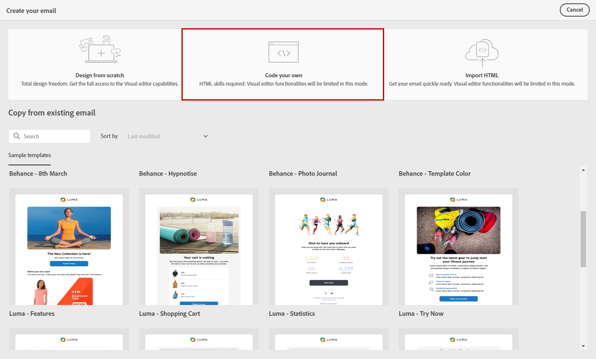
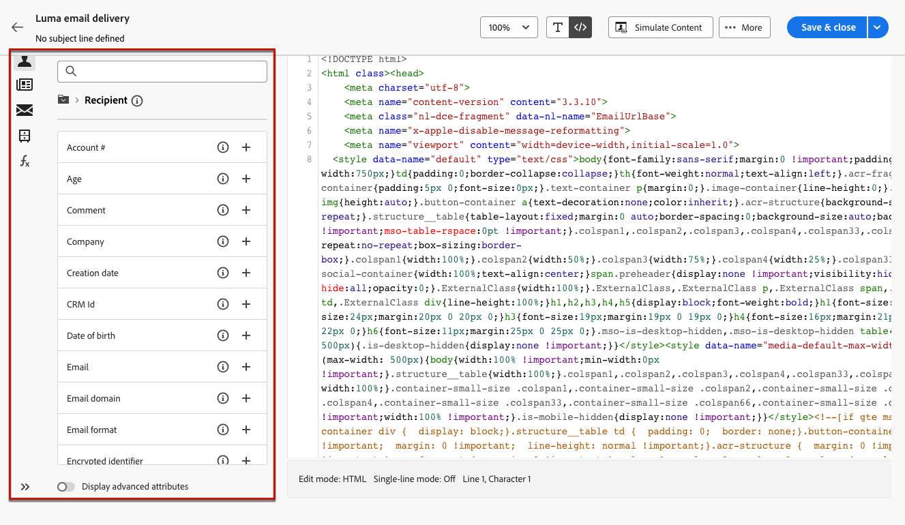

# 撰寫您自己電子郵件內容的程式碼 {#code-content}

使用您自己的&#x200B;**[!UICONTROL 編碼模式]**&#x200B;來匯入原始HTML並編碼您的電子郵件內容。

>[!CAUTION]
>
>此方法需要具備HTML知識。

>[!IMPORTANT]
>
>請勿在您的電子郵件內容中使用HTML `<base>`標籤。 基於安全理由，此標籤不受支援，且可能會阻止您的內容在內容編輯器中載入。 請改用連結和外部資源的絕對網址。

1. 在[電子郵件Designer](get-started-email-designer.md)首頁上，選取&#x200B;**[!UICONTROL 自行編碼]**。

   {zoomable="yes"}

1. 將您的原始HTML程式碼輸入或貼到主畫布中。

1. 使用左窗格來存取個人化功能。 [了解更多](../personalization/gs-personalization.md)

   {zoomable="yes"}

1. 按一下「**[!UICONTROL 模擬內容]**」按鈕，以使用測試設定檔預覽訊息設計和個人化。 [了解更多](../preview-test/preview-test.md)

1. 程式碼完成後，按一下&#x200B;**[!UICONTROL 儲存並關閉]**&#x200B;以返回訊息建立畫面並完成訊息。