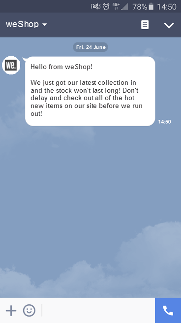

# 開始使用LINE訊息 {#get-started-line}

LINE 是免費應用程式，可傳送即時訊息、進行語音與視訊通話，適用所有行動裝置與個人電腦。 您可以使用Adobe Campaign傳送LINE訊息。 在獨立傳遞或工作流程中，與其他管道搭配使用LINE。

* **[!UICONTROL 傳遞]**：從左側邊欄上的&#x200B;**[!UICONTROL 傳遞]**&#x200B;功能表，建立獨立的LINE傳遞，類似SMS或推播。 [了解更多資訊](send-line.md)。

* **[!UICONTROL 工作流程]**：在工作流程畫布中新增&#x200B;**[!UICONTROL LINE]**&#x200B;頻道活動、選擇傳遞範本，然後在傳遞控制面板中定義內容和設定。 在[本節](../workflows/activities/channels.md)中進一步瞭解管道活動。

  >[!NOTE]
  >
  >在摘要您&#x200B;**[!UICONTROL LINE]**&#x200B;頻道活動的&#x200B;**[!UICONTROL 建立對象]**&#x200B;活動中，將目標維度變更為&#x200B;**[!UICONTROL 訪客訂閱]**。 請確定您已啟用側面板中的&#x200B;**[!UICONTROL 顯示所有結構描述]**。 只有在設定此目標維度後，才能使用傳遞範本選取器。
