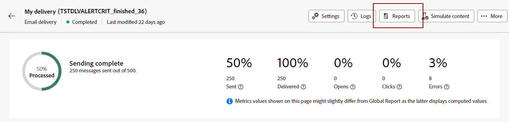

# 開始使用動態報告 {#about-dynamic-reports}

動態報告提供完全可自訂的即時報告。 它新增了對輪廓資料的存取權，除了功能性電子郵件行銷活動資料 (如開啟數和點按數) 外，還可依輪廓維度 (例如，性別、城市和年齡) 進行人口統計分析。 透過拖放介面，您可以探索資料、判斷電子郵件促銷活動對最重要客戶細分的執行方式，並評估其對收件者的影響。

## 存取動態報表 {#accessing-dynamic-reports}

按一下&#x200B;**報表**，即可存取每個行銷活動和傳遞中的報表。 將會出現快顯視窗，通知您將在新的瀏覽器分頁中重新導向至&#x200B;**動態報告**&#x200B;頁面。

某些報表在傳送後無法立即使用，視收集和處理資訊所花費的時間而定。

動態報告分為兩個類別：

* **範本**，可以使用&#x200B;**另存新檔**&#x200B;選項（**專案>另存新檔……**）來複製範本 在範本中。
* **自訂報告** （以藍色識別），可以按一下&#x200B;**報告**&#x200B;首頁上的&#x200B;**建立新專案**&#x200B;按鈕直接建立。

