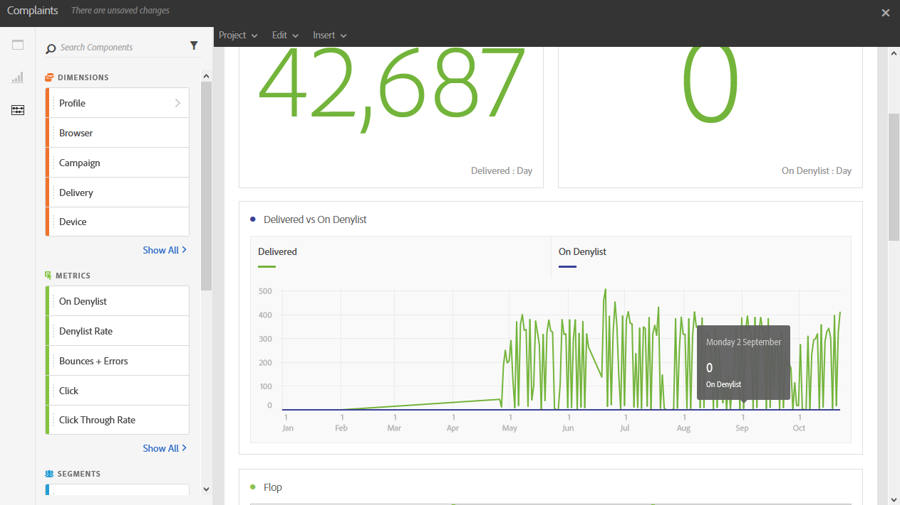

# 投訴{#complaints}

**[!UICONTROL 「申訴」]**&#x200B;報表可識別收到最多宣告為垃圾訊息的交付項目。

按收件者網域排序的&#x200B;**Flop**&#x200B;表格會顯示已宣告電子郵件或垃圾郵件的收件者數目。 表格的結果也可顯示在圖表和摘要數字中。

**已傳遞與封鎖清單**&#x200B;表格列出已將電子郵件宣告為垃圾郵件或垃圾郵件的收件者人數。 表格會依傳遞排序。
