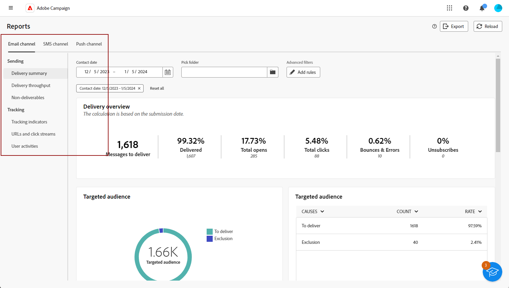
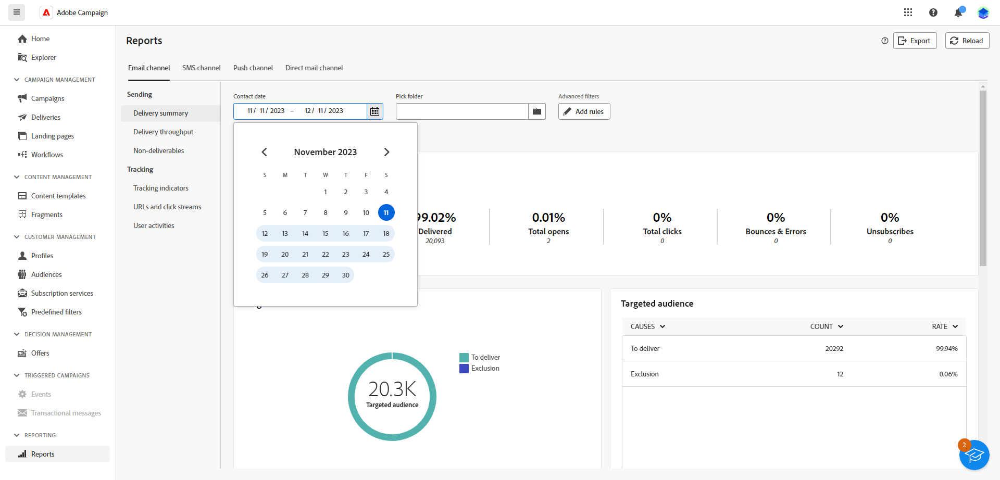
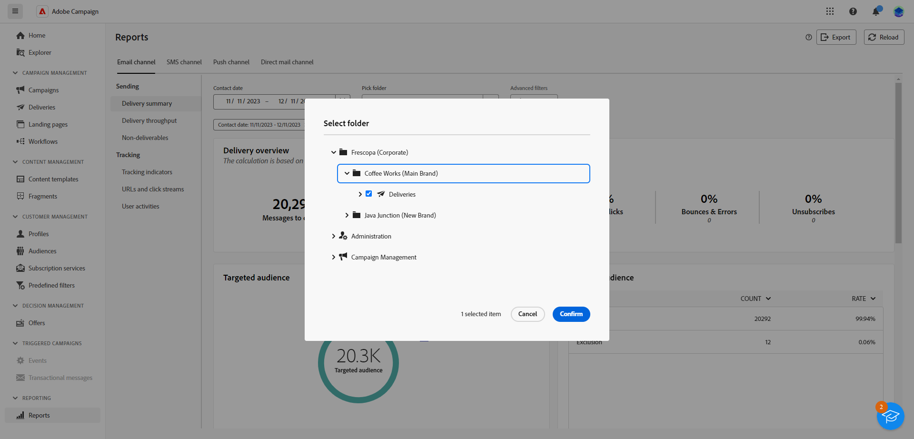

# 開始使用全域報告 {#global-report-gs}

>[!CONTEXTUALHELP]
>id="acw_campaign_reporting_global_report"
>title="全域報告"
>abstract="全域報告是分析行銷活動績效的強大有效方法。 這些報告會為您的行銷活動提供每個頻道關鍵流量和參與量度的整合檢視。"

**全域報告**&#x200B;是一種有效的工具，可為行銷活動執行個體中的每個管道提供流量和參與量度的整合性總體摘要。 這些報告是由各種小工具所組成，每個小工具都提供有關您的行銷活動或傳遞績效的獨特觀點。

關鍵績效指標(KPI)每小時會重新整理一次，以確保獲得最新的深入分析。 依預設，資料篩選器涵蓋過去30天，提供您行銷活動和傳遞績效的最新及相關觀點。

各管道的完整報表和相關量度清單可在下列頁面取得：

* [以電子郵件傳送全域報告](global-report-email.md)
* [SMS全域報告](global-report-sms.md)
* [推播全域報告](global-report-push.md)
* [直接郵件全域報告](global-report-direct.md)

## 管理您的報告儀表板 {#manage-reports}

若要存取及管理全域報告，請遵循下列步驟：

1. 瀏覽至&#x200B;**[!UICONTROL 報表]**&#x200B;區段內的&#x200B;**[!UICONTROL 報表]**&#x200B;功能表。

1. 在左側功能表中，從清單中選取報表，並導覽至標籤，以顯示每個管道的資料。

   {zoomable="yes"}

1. 從您的儀表板，選擇&#x200B;**開始**&#x200B;和&#x200B;**[!UICONTROL 結束時間]**&#x200B;以鎖定特定資料。

   {zoomable="yes"}

1. 從&#x200B;**[!UICONTROL 挑選資料夾]**&#x200B;欄位中，選取是否要從特定資料夾中鎖定傳遞或行銷活動。

   {zoomable="yes"}

1. 按一下&#x200B;**[!UICONTROL 新增規則]**&#x200B;以開始建立查詢，以更好地篩選報表資料。 [瞭解如何使用查詢模型工具](../query/query-modeler-overview.md)。

1. 從&#x200B;**[!UICONTROL URL並按一下串流]**，選擇&#x200B;**[!UICONTROL 最常造訪的連結]**&#x200B;或&#x200B;**[!UICONTROL 時段]**。

   **[!UICONTROL 檢視依據]**&#x200B;選項允許篩選URL、標籤或類別。

## LINE頻道報表 {#line-reports}

可用於LINE頻道的報表如下所述。

### 傳遞概觀 {#line-delivery-overview}

>[!CONTEXTUALHELP]
>id="acw_global_reporting_line_deliveries_overview"
>title="LINE交貨概要"
>abstract="檢視LINE要傳遞的訊息、傳遞的訊息及傳遞錯誤。"

**[!UICONTROL 傳遞總覽]**&#x200B;報告會顯示LINE要傳遞的訊息、傳遞的訊息及傳遞錯誤。

### 目標對象 {#line-targeted-audience}

>[!CONTEXTUALHELP]
>id="acw_global_reporting_line_targeted_audience"
>title="LINE目標對象"
>abstract="檢視LINE傳遞所定位的對象以及產生的傳遞結果。"

**[!UICONTROL 目標對象]**&#x200B;圖形與表格會顯示LINE傳遞所目標對象與產生的傳遞結果。

### 傳遞統計資料 {#line-delivery-stats}

>[!CONTEXTUALHELP]
>id="acw_global_reporting_line_delivery_stats"
>title="LINE傳遞統計資料"
>abstract="檢視LINE訊息的主要傳遞結果，包括要傳遞的訊息、傳遞的訊息及傳遞錯誤。"

**[!UICONTROL 傳遞統計資料]**&#x200B;圖表和表格顯示LINE訊息的金鑰傳遞結果，包括要傳遞的訊息、傳遞的訊息以及傳遞錯誤。

### 排除的原因 {#line-exclusions}

>[!CONTEXTUALHELP]
>id="acw_global_reporting_line_exclusions"
>title="LINE排除的原因"
>abstract="檢視目標設定檔從LINE傳遞排除的原因，例如適用性、驗證或設定規則。"

**[!UICONTROL 排除原因]**&#x200B;圖表和表格顯示目標設定檔從LINE傳遞中排除的原因，例如適用性、驗證或設定規則。

### 傳遞總輸送量 {#line-delivery-throughput}

>[!CONTEXTUALHELP]
>id="acw_global_reporting_throughput_line"
>title="LINE傳遞輸送量"
>abstract="檢視LINE訊息在一段時間內的傳送率。"

**[!UICONTROL 傳遞輸送量]**&#x200B;報告顯示一段時間內的LINE訊息傳送率。
